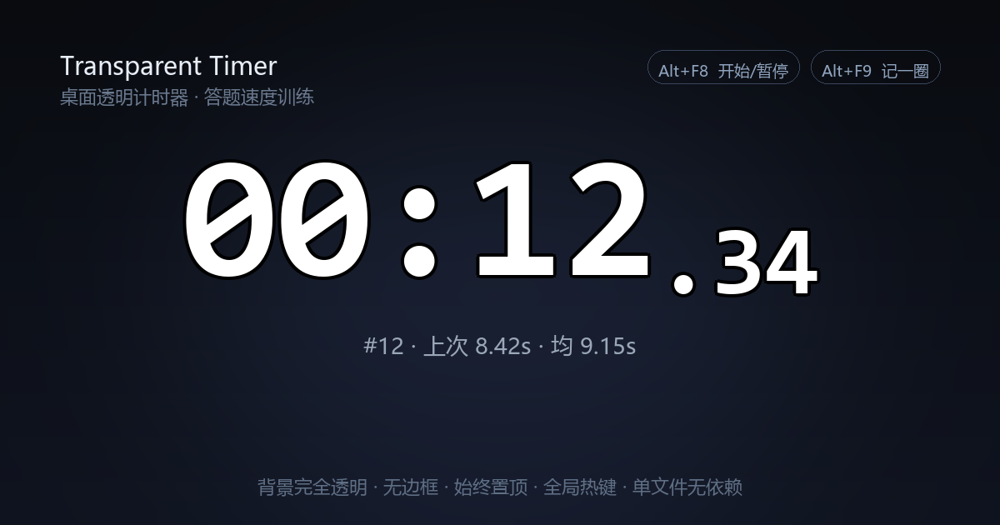

# Transparent Timer · 桌面透明计时器



一个**悬浮在桌面上的透明计时器**。没有窗口边框、没有背景板，数字直接浮在壁纸上，不挡视线、不打断节奏。

最初是为了练**答题速度**做的：看题 → 开始 → 答完按一下 → 立刻进入下一题，每一轮用时自动记录，随时能看到平均和最快成绩。后来发现它其实什么计时场景都能干，就做成了现在这样。

> Windows · Python 3 · 纯标准库 · 单文件 · 无需安装依赖

---

## 多用途

| 场景 | 怎么用 |
|---|---|
| **答题 / 刷题竞速** | 记圈模式：每题一记，自动归零，统计平均与最快 |
| **打字测速** | 打一段按一次记圈，看自己稳定在多少秒 |
| **番茄工作法** | 倒计时预设 25:00，结束响铃 |
| **演讲 / 辩论 / 汇报** | 倒计时 3:00 / 4:00，超时数字变红 |
| **面试模拟答题** | 倒计时 5:00，控制每题作答时长 |
| **HIIT / 间歇训练** | 倒计时 0:45，循环计时 |
| **考试模考** | 倒计时整场，最后几分钟盯一眼 |
| **烹饪 / 泡茶 / 煮咖啡** | 倒计时，随时扫一眼不用切窗口 |
| **冥想 / 专注** | 极简数字，不打扰 |

---

## 核心玩法：答题竞速

这是它最常用的方式。

1. 把计时器拖到屏幕角落（比如题目旁边）
2. 按下开始（双击数字，或按全局热键）
3. 答完这道题，按一下**记圈键**
4. 用时自动记入成绩，数字归零，**立刻进入下一题**（不用手动重置）

一轮下来，副行会实时显示 `#12 · 上次 8.42s · 均 9.15s`。
右键 → 成绩 → 查看记录，可以看到完整列表：最快绿色、最慢红色，还有中位数。

想给自己定个线？右键 → 目标用时 → 选 10 秒。
超过 10 秒数字立刻变红，一眼就知道这题慢了。

刷完一组，右键 → 成绩 → 导出 CSV，用 Excel 看趋势。

---

## 功能

**计时**
- 正计时 / 倒计时双模式，倒计时带结束响铃 + 闪烁提醒
- 百分秒显示，小数部分自动缩小字号（专业计时器的排版）
- 运行时冒号每 0.5 秒闪烁
- 记圈：记录当前成绩并立即归零进入下一轮
- 撤销上一条成绩（手滑记错时用）
- 目标用时：超时数字变红
- 成绩统计：次数 / 平均 / 最快 / 最慢 / 中位数
- 导出 CSV（含相对平均的偏差）

**外观**
- 背景完全透明（真透明，不是贴图），点击还能穿透到下层窗口
- 数字带描边，深色壁纸、浅色文档、复杂背景上都清晰
- 6 种配色：白、黑、金、青、朱红、薄荷
- 字号 20~420，滚轮随手调
- 整体不透明度 40%~100%
- 运行 / 暂停 / 超时 / 记圈 四种状态有不同颜色

**操作**
- 无边框、始终置顶、可拖动，位置自动记住
- 全局热键：开始/暂停、记一圈、显示/隐藏（都可自定义）
- 双击开始/暂停，滚轮缩放，右键菜单
- 锁定位置，防止误拖
- 开机自启（可选）
- 所有设置持久化到 `timer_config.json`

---

## 快速开始

```bash
# 1. 确认有 Python 3（自带 tkinter）
python --version

# 2. 直接运行
python desktop_timer.py
```

Windows 上也可以双击 `启动计时器.bat`，用 `pythonw` 启动，不会弹黑框。

首次启动会在屏幕中央显示一张操作说明卡片，9 秒后自动消失。

---

## 默认热键

全局生效，任何窗口下都能按。

| 热键 | 作用 |
|---|---|
| `Alt` + `F8` | 开始 / 暂停 |
| `Alt` + `F9` | 记一圈（记录成绩 + 归零） |
| `Ctrl` + `Alt` + `H` | 显示 / 隐藏（默认关闭，可在菜单里开） |

改法：右键 → 快捷键 → 自定义开始/暂停键…，弹出窗口后**直接按下你想用的组合**即可。
如果这个组合已被别的软件占用，会当场提示，不会留下一个失效的热键。

> 规则：必须带 Ctrl / Alt / Shift，或直接用 F1~F12。这是为了避免单独一个字母被全局拦截，导致正常打字时误触。

---

## 右键菜单

```
开始 / 暂停
记一圈
撤销上一条成绩
重置
──────────────
模式          正计时 / 倒计时
倒计时        番茄钟 25:00 · 短休息 5:00 · 演讲 3:00 · 辩论 4:00 · 面试答题 5:00 · HIIT 0:45 · 自定义
目标用时      不设 / 5s / 8s / 10s / 15s / 20s / 30s / 45s / 60s / 自定义
──────────────
成绩          查看记录 / 导出 CSV / 清空
──────────────
颜色 · 字号 · 显示百分秒 · 显示统计行
不透明度 · 总在最前 · 锁定位置
快捷键 · 开机自启
──────────────
帮助 / 操作说明 · 退出
```

---

## 数据

所有状态存在同目录的 `timer_config.json`：

```json
{
  "x": 900, "y": 300,
  "font_size": 70,
  "mode": "up",
  "target": 10.0,
  "laps": [8.42, 9.1, 6.03],
  "theme": "白字",
  "hotkey": {"mods": 1, "vk": 119, "enabled": true}
}
```

- 成绩最多保留 500 条，超出后丢弃最早的
- 删掉这个文件就恢复默认设置
- 不会上传任何数据，全部在本机

---

## 实现说明

几个值得记下来的点：

**真透明**
用 `root.attributes("-transparentcolor", KEY)` 把背景色抠成透明，配合 `overrideredirect(True)` 去掉边框。透明区域的像素连鼠标事件都不接收，所以能点到下面的窗口。

**文字描边**
Canvas 上先画 8 个方向偏移的深色文字层，再画中心的主体文字，任何壁纸下都清晰。描边层只在文字变化时 `itemconfigure`，不重建。

**主数字 + 小数字**
主文本和小数部分用两个独立字体对象、两个 text item，按基线对齐（`anchor="sw"` 配合 descent 差值），得到专业计时器的排版。

**全局热键**
Windows 的 `RegisterHotKey` 有两个坑：

1. 不能用 ctypes 子类化 Tk 的窗口过程来接 `WM_HOTKEY` —— tkinter 在 `Tcl_DoOneEvent` 期间会释放 GIL，ctypes 回调撞上这个时机直接崩（`PyEval_RestoreThread: the GIL is released`）。
2. `RegisterHotKey` 必须由**拥有目标窗口的线程**调用。主线程拿别的线程创建的 hwnd 去注册会静默失败，返回 0 但没有任何报错。

最终方案：独立线程建一个 message-only 窗口（`HWND_MESSAGE`），自己跑 `PeekMessage`/`DispatchMessage` 循环，热键注册也在这个线程内完成；主线程通过命令队列下发指令、结果队列取回是否成功。

**计时精度**
用 `time.monotonic()` + 累计值，不做定时器累加，长时间计时不会漂移。

---

## 环境

- Windows 10 / 11
- Python 3.8+（自带 tkinter 即可，不需要 pip install）
- 全局热键依赖 Windows API；非 Windows 平台会自动跳过，其余功能正常

---

## License

MIT
